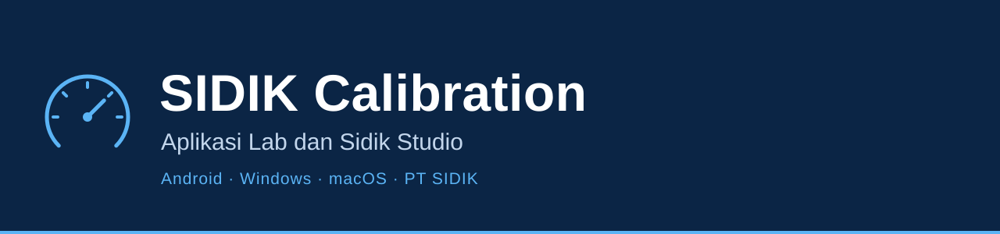
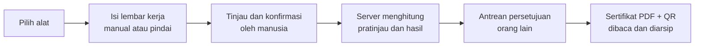
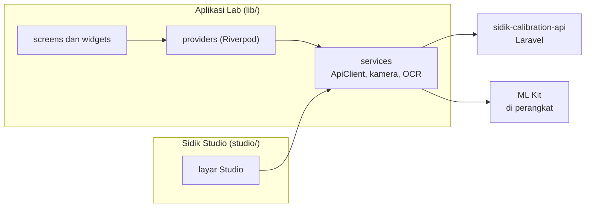
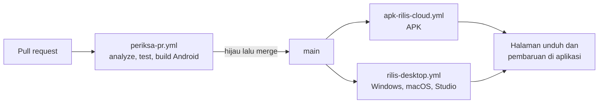

<p align="center">
  
</p>

<p align="center">
  <a href="https://github.com/ZainulArkaanAlinsi/sidik-calibration-mobile/actions/workflows/periksa-pr.yml"></a>
  <a href="https://github.com/ZainulArkaanAlinsi/sidik-calibration-mobile/releases/latest"></a>
  
  
  
  
</p>

> **English.** SIDIK Calibration Lab is the Flutter app that technicians and staff of the PT SIDIK calibration laboratory use to fill in calibration worksheets, send them for independent approval and read the resulting certificates. All calculations run on the server ([`sidik-calibration-api`](https://github.com/ZainulArkaanAlinsi/sidik-calibration-api)); the optional worksheet scan reads photos on the device and only proposes values that a person must confirm (test mode). The repo also holds Sidik Studio (`studio/`), a separate Windows and tablet app for reference data and master workbooks, whose editing features are still on the roadmap. A support system for a KAN-accredited laboratory (LK-285-IDN); under active development.

**Isi:** [Ringkasan](#ringkasan) · [Peran dan fitur](#peran-dan-fitur) · [Cara kerja](#cara-kerja) · [Arsitektur](#arsitektur) · [Sidik Studio](#sidik-studio) · [Prinsip integritas](#prinsip-integritas) · [Teknologi](#teknologi) · [Menjalankan secara lokal](#menjalankan-secara-lokal) · [Pengujian](#pengujian-dan-rilis) · [Dokumentasi](#dokumentasi) · [Status dan peta jalan](#status-dan-peta-jalan) · [Kontribusi dan kepemilikan](#kontribusi-dan-kepemilikan)

## Ringkasan

Aplikasi Lab dipakai teknisi dan staf PT SIDIK untuk mengerjakan kalibrasi alat ukur tanpa lembar kertas dan Excel: pilih alat, isi lembar kerja (manual atau dari foto lembar kertas), kirim untuk persetujuan, lalu baca sertifikat digital yang terbit. Satu aplikasi dipakai semua peran internal; menu mengikuti izin yang diberikan server.

Aplikasi tidak menghitung angka sendiri. Pratinjau dan hasil akhir dihitung server, karena dua angka berbeda untuk satu pengukuran adalah temuan audit di laboratorium terakreditasi. Sistem pendukung laboratorium terakreditasi KAN LK-285-IDN.

## Peran dan fitur

| Peran | Yang dapat dilakukan di aplikasi |
| --- | --- |
| Teknisi | Mengisi lembar kerja (isian atau pindai), menyimpan draf, pratinjau hasil, mengirim untuk persetujuan, melihat penugasan, riwayat, dan notifikasi. |
| Master Data | Semua milik teknisi, ditambah antrean persetujuan, koreksi dengan alasan, perbandingan nilai asli dan koreksi, lembar perhitungan, kelola data master (alat, pelanggan, standar, ruangan, metode), arsip, penugasan, dan undangan anggota pelanggan. |
| Super Admin | Semua aksi teknisi dan Master Data di organisasinya, beranda ringkasan, serta pengaktifan versi data acuan. |
| Viewer | Baca saja. Tidak ditawarkan untuk akun baru; akun lama tetap berlaku. |
| Pelanggan | Memakai aplikasi terpisah: [`sidik-pelanggan-mobile`](https://github.com/ZainulArkaanAlinsi/sidik-pelanggan-mobile). |

Menyembunyikan menu bukan kontrol akses: izin diambil dari server (`/me/permissions`) dan server tetap menolak aksi yang tidak berhak.

| Area | Isi |
| --- | --- |
| Lembar kerja | Pilih kategori dan alat, lembar dibentuk dari skema server, draf lokal, ringkasan sebelum kirim. |
| Pindai lembar kerja | Foto lembar kertas, OCR di perangkat, usulan angka per sel, wajib dikonfirmasi. Mode uji. |
| Persetujuan | Antrean, perbandingan nilai asli dan koreksi, lembar perhitungan, koreksi dengan jejak. |
| Sertifikat | Lihat PDF di aplikasi, revisi, tarik, kirim email, telusuri. |
| Arsip dan pelacakan | Arsip per perusahaan, jatuh tempo, pelacakan paket, penugasan. |
| Data acuan | Alur versi parameter acuan: ajukan, simulasi, banding, riwayat. |
| Notifikasi | Realtime lewat websocket dan notifikasi push. |
| Lain-lain | Dwibahasa ID dan EN, pembaruan di dalam aplikasi. |

## Cara kerja



Hasil pindai tidak pernah langsung tersimpan. Tombol lanjut tetap mati selama masih ada sel kosong, termasuk sel yang keyakinan pembacanya tidak diketahui: `null` berarti tidak diketahui, bukan "yakin", dan diperlakukan sebagai belum terisi (`lib/services/pembaca_halaman.dart`). Tidak ada tombol "terima semua". Input manual selalu tersedia dan masuk lewat jalur yang sama dengan hasil pindai.

## Arsitektur



| Lapisan | Tempat |
| --- | --- |
| Konfigurasi, tema, utilitas | `lib/core/` |
| Model data | `lib/models/` |
| Layanan (API, auth, kamera, OCR) | `lib/services/` |
| State (Riverpod) | `lib/providers/` |
| Layar dan komponen | `lib/screens/`, `lib/widgets/` |
| Teks dwibahasa | `lib/l10n/` |
| Sidik Studio | `studio/`, memakai lapisan data yang sama lewat dependensi `path` |

## Sidik Studio

Aplikasi terpisah (Windows dan tablet Android) untuk memegang data acuan dan master Excel jarak jauh. Server tetap satu-satunya tempat hitung; Studio tidak menghitung sendiri. Seksi yang belum dibangun tampil nonaktif dengan label tahapnya.

| Seksi | Status |
| --- | --- |
| Beranda | Tersedia |
| Data Acuan (alur versi, simulasi, banding, riwayat) | Tersedia, baca saja; mengajukan dan mengaktifkan versi dilakukan di aplikasi Lab |
| Workbook master per alat (mode baca, unggah master) | Tersedia |
| Kelola Data, Lembar Hitung (editor rumus), Pengesahan, Impor, Pengaturan | Peta jalan, belum tersedia |

Rincian: [`studio/README.md`](studio/README.md).

## Prinsip integritas

- **Server yang menghitung.** Angka di layar dan angka di sertifikat berasal dari mesin hitung yang sama.
- **Saran, bukan keputusan.** OCR hanya mengusulkan; sel yang tidak jelas tetap kosong, dan manusia yang mengonfirmasi.
- **Nilai teknisi tidak dihapus.** Koreksi menyimpan nilai lama, nilai baru, dan alasan.
- **Pemisahan wewenang.** Pengisi lembar tidak dapat menyetujui lembar yang sama; aturan ini ditegakkan di server.
- **Sertifikat terbit tidak ditimpa.** Perubahan lahir sebagai revisi.

## Teknologi

| Lapisan | Teknologi |
| --- | --- |
| Framework | Flutter 3.44.6 (dipatok di CI), Dart `^3.11.5` |
| State | Riverpod 3 (`flutter_riverpod ^3.3.2`) |
| Jaringan dan sesi | `http`, token di `flutter_secure_storage` |
| PDF | `pdfrx` |
| OCR dan QR | `google_mlkit_text_recognition`, `google_mlkit_barcode_scanning`; semuanya di perangkat |
| Mesin angka TFLite | Di balik sakelar `PAKAI_MESIN_ANGKA`, mati bawaan; ML Kit tetap pembaca bawaan |
| Realtime dan push | `web_socket_channel` (protokol Reverb), `firebase_messaging` |
| Platform | Android (APK), Windows, macOS |

## Menjalankan secara lokal

```bash
git clone https://github.com/ZainulArkaanAlinsi/sidik-calibration-mobile.git
cd sidik-calibration-mobile
git config core.hooksPath .githooks   # menolak push langsung ke main
flutter pub get
./tool/dev.sh mock                    # tanpa server; atau: mac, windows, hp
```

`./tool/dev.sh mac|windows|hp` menembak API lokal di port 8000. Untuk HP fisik, skrip memakai `adb reverse` sehingga aplikasi mengakses `127.0.0.1`; jangan mengisi IP LAN, karena nilainya berubah dan Android menolak HTTP polos ke alamat yang tidak terdaftar. Backend lokal: lihat [`sidik-calibration-api`](https://github.com/ZainulArkaanAlinsi/sidik-calibration-api#menjalankan-secara-lokal).

Tidak ada alamat server yang ditanam di kode; semuanya lewat `--dart-define` (`lib/core/config/app_config.dart`):

| Kunci | Bawaan | Keterangan |
| --- | --- | --- |
| `APP_ENV` | `dev` | `dev`, `staging`, atau `prod` |
| `API_BASE_URL` | `http://10.0.2.2:8000/api` | `10.0.2.2` adalah localhost laptop dilihat dari emulator Android |
| `USE_MOCK` | `false` | `true` untuk data contoh tanpa server |

Menyiapkan mesin kedua (versi Flutter yang sama, berkas yang tidak ikut git): [`docs/sinkron-laptop-windows.md`](docs/sinkron-laptop-windows.md).

## Pengujian dan rilis

```bash
flutter analyze                       # harus 0 issue
flutter test                          # test unit dan widget
flutter test integration_test -d <id> # butuh perangkat
cd studio && flutter analyze && flutter test
```

Golden test dibuat dan diperiksa di macOS lewat workflow tersendiri (`golden-baru.yml`, `golden-beku.yml`), karena hasil render berbeda antar sistem operasi.



APK dirilis otomatis hanya bila yang berubah ikut ke dalam aplikasi (`lib/`, `android/`, `assets/`, `pubspec*`). Aplikasi yang terpasang menawarkan pembaruan sendiri. Halaman unduh: <https://sidik-kalibrasi.web.app>; cara kerjanya di [`docs/deploy-firebase.md`](docs/deploy-firebase.md).

## Dokumentasi

| Dokumen | Isi |
| --- | --- |
| [`studio/README.md`](studio/README.md) | Sidik Studio: menjalankan, struktur, pembaru |
| [`docs/deploy-firebase.md`](docs/deploy-firebase.md) | Halaman unduh dan rilis desktop |
| [`docs/sinkron-laptop-windows.md`](docs/sinkron-laptop-windows.md) | Menyamakan mesin pengembangan |
| [`docs/standar-kualitas-desain.md`](docs/standar-kualitas-desain.md) | Standar kualitas desain dan gerbang otomatisnya |
| [`docs/pindai-lembar-kerja-hp.md`](docs/pindai-lembar-kerja-hp.md) | Peta berkas pindai lembar kerja di sisi HP |
| [`docs/ocr-angka-onnx.md`](docs/ocr-angka-onnx.md) | Mesin angka TFLite di balik sakelar |
| [`docs/pihak-ketiga-ocr.md`](docs/pihak-ketiga-ocr.md) | Pihak ketiga dan lisensi untuk OCR |
| [`docs/rilis-tanda-tangan-apk.md`](docs/rilis-tanda-tangan-apk.md) | Penandatanganan APK rilis |
| [Kontrak API](https://github.com/ZainulArkaanAlinsi/sidik-calibration-api/blob/main/docs/kontrak-api.md) | Kontrak endpoint (versi kanonik di repo API) |

## Status dan peta jalan

Dalam pengembangan aktif (per 18 Nov 2026).

| Status | Isi |
| --- | --- |
| Berjalan | Lembar kerja dan pratinjau, persetujuan, sertifikat, arsip, penugasan, pelacakan, notifikasi, alur versi data acuan, rilis otomatis. Studio: beranda, data acuan (baca saja), workbook master (mode baca). |
| Mode uji | Pindai lembar kerja: hanya usulan, wajib dikonfirmasi manusia. Mesin angka TFLite mati bawaan sampai terbukti di tablet. |
| Belum | Studio: Kelola Data, Lembar Hitung, Pengesahan, Impor, Pengaturan. |

## Kontribusi dan kepemilikan

Proyek ini dikembangkan untuk PT SIDIK dan dipelihara oleh Zainul Arkaan. Informasi laboratorium: <https://pt-sidik.com/calibration/>.

- Perubahan lewat pull request ke `main` dengan CI hijau; jangan push langsung. Penggabungan ke `main` memicu rilis otomatis bila yang berubah ikut ke dalam aplikasi.
- Commit memakai [Conventional Commits](https://www.conventionalcommits.org/). `flutter analyze` harus bersih. Jangan menyertakan `pubspec.lock` yang bergeser karena SDK lokal.
- Repo ini publik: jangan menulis kredensial, token, atau data pelanggan asli di berkas, tangkapan layar, maupun berkas contoh.
- Repo ini belum memuat berkas `LICENSE`; ketentuan penggunaan ulang belum ditetapkan.
